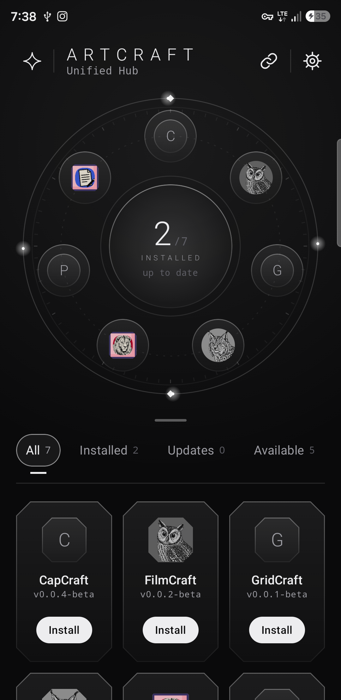
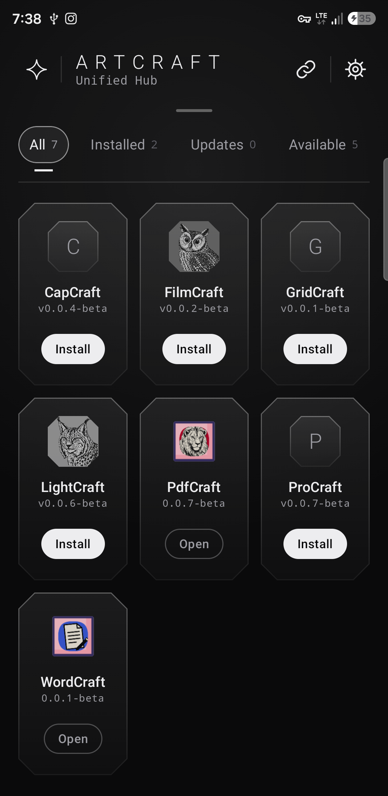
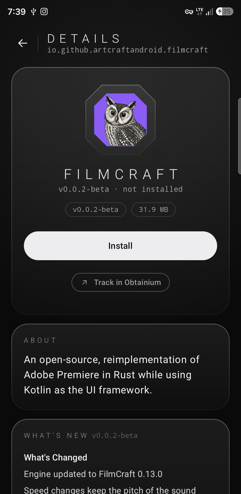
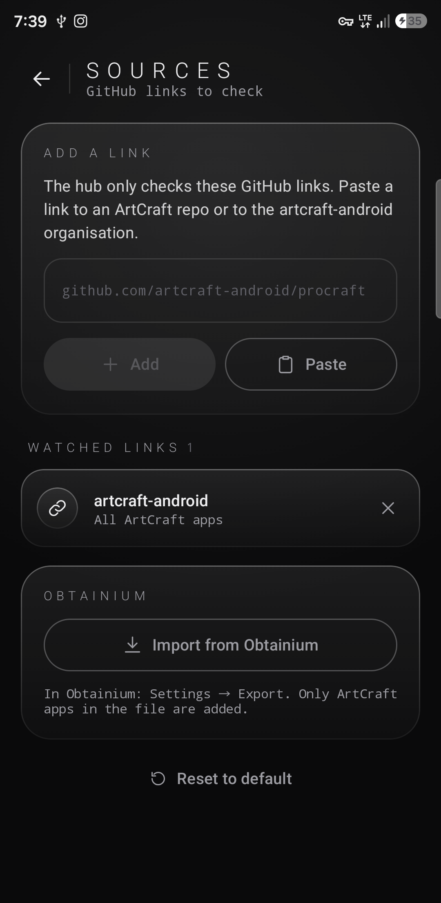
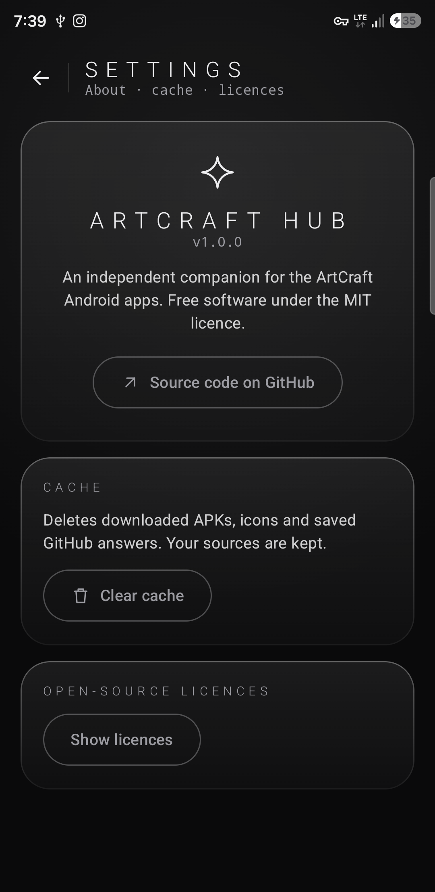

# ArtCraft Hub for Android

One place to find, install, update and open the [ArtCraft Android apps](https://github.com/artcraft-android):
ProCraft, PdfCraft, LightCraft, GridCraft, WordCraft, CapCraft, FilmCraft and any new ones the
organisation publishes.

The hub reads the apps' GitHub releases, picks the right APK for your phone (64-bit, 32-bit or
x86_64), checks it against the release's `SHA256SUMS.txt` when there is one, and hands it to
Android's installer. It doesn't run its own servers and doesn't collect any data.

[](https://apps.obtainium.imranr.dev/redirect?r=obtainium%3A%2F%2Fapp%2F%257B%2522id%2522%253A%2522io.github.l41n_pr0t0.artcrafthub%2522%252C%2522url%2522%253A%2522https%253A%252F%252Fgithub.com%252Fl41n-pr0t0%252FArtCraftHub-android%2522%252C%2522author%2522%253A%2522l41n-pr0t0%2522%252C%2522name%2522%253A%2522ArtCraft%2520Hub%2522%252C%2522additionalSettings%2522%253A%2522%257B%255C%2522includePrereleases%255C%2522%253Afalse%252C%255C%2522fallbackToOlderReleases%255C%2522%253Atrue%257D%2522%257D)

<p>
  
  
  
  
  
</p>

## Features

- **Catalogue** of every ArtCraft app, betas included, with icons, descriptions and release notes.
- **Install, update, open and uninstall** from one screen. An update button appears when GitHub
  has a newer release than the one on your phone.
- **Sources**: the hub checks only the links you list. The `artcraft-android` organisation is there
  by default; you can add single repos, remove them, or import the ArtCraft apps from an
  [Obtainium](https://github.com/ImranR98/Obtainium) export. Only `github.com/artcraft-android`
  links are accepted.
- **Track in Obtainium**: one tap adds an app to Obtainium, with pre-releases included, if you'd
  rather it handle updates.
- **A dark, monochrome glass design**: every app orbits a counter of what's installed; apps you
  don't have yet are shown in grey and take on their colours once installed. Works on small and
  large phones, foldables and tablets, and with large system fonts.
- Fast and small: about a 4 MB download, and the cached list shows in roughly 150 ms on a recent phone.

## Install

1. Download `artcrafthub-<version>-arm64-v8a.apk` from the
   [latest release](https://github.com/l41n-pr0t0/ArtCraftHub-android/releases). Use the
   `armeabi-v7a` file on older 32-bit phones and `x86_64` on emulators and Chromebooks.
2. Open it and allow your browser or file manager to install apps when Android asks.
3. In the hub, tap **Install** on an app. The first time, Android asks you to allow the hub to
   install apps. Every install and uninstall is confirmed by Android's own dialog.

Or add the hub to Obtainium with the badge above: it follows the hub's stable releases and picks
the APK for your phone. To track an ArtCraft app in Obtainium by hand, turn on **Include prereleases**:
the ArtCraft apps only publish pre-releases so far, and without it Obtainium says "Could not find
a suitable release".

Every release is signed with the same key, so a new version installs over the old one (from the
release page, from Obtainium, or over the 0.1.0 beta) and keeps your sources.

If an app was installed from somewhere else and signed with a different key, Android refuses to
update it; the hub tells you to uninstall it first.

## Build

The core is Rust (GitHub client, release parsing, APK choice, downloads with checksum checks) and
is called from a Kotlin + Jetpack Compose app through [UniFFI](https://mozilla.github.io/uniffi-rs/).

Needs: Nix with flakes, or by hand Rust 1.95+, `cargo-ndk`, JDK 21, the Android SDK and
NDK 27.2.12479018. [CONTRIBUTING.md](CONTRIBUTING.md) walks through setting these up without Nix.

```sh
nix develop                     # Rust with the Android targets, cargo-ndk, JDK 21, adb
cargo test --workspace          # the Rust core's tests
cd android
./gradlew :app:testDebugUnitTest :app:assembleDebug
./gradlew :app:installDebug -Phub.abis=arm64-v8a   # onto a connected phone
```

`-Phub.abis=` picks which ABIs the Rust library is built for (default `arm64-v8a,x86_64`).
Release builds are signed with the key named by `HUB_KEYSTORE`, `HUB_KEYSTORE_PASSWORD`,
`HUB_KEY_ALIAS` and `HUB_KEY_PASSWORD`, or with the debug key when those are unset.

Layout:

```
crates/hub-core      Rust core, exported to Kotlin with UniFFI
crates/hub-bindgen   the uniffi-bindgen binary the Gradle build runs
android/             the app (Gradle builds the Rust library with cargo-ndk)
docs/superpowers     design spec and implementation plan
```

## Releasing

Set `hub.version` and `hub.versionCode` in `android/gradle.properties`, then push a tag `v<version>`.
The release workflow builds one signed APK per ABI, writes `SHA256SUMS.txt` and publishes the
GitHub Release. Tags with a `-` (like `v0.2.0-beta`) are marked as pre-releases.

## Roadmap

Planned for [1.1.0](https://github.com/l41n-pr0t0/ArtCraftHub-android/milestone/1): accessibility
labels for the app ring ([#1](https://github.com/l41n-pr0t0/ArtCraftHub-android/issues/1)), more tests
([#2](https://github.com/l41n-pr0t0/ArtCraftHub-android/issues/2)), translatable text
([#3](https://github.com/l41n-pr0t0/ArtCraftHub-android/issues/3)) and release dates
([#4](https://github.com/l41n-pr0t0/ArtCraftHub-android/issues/4)).

Later: background update checks ([#6](https://github.com/l41n-pr0t0/ArtCraftHub-android/issues/6)),
an optional GitHub token ([#7](https://github.com/l41n-pr0t0/ArtCraftHub-android/issues/7)),
a baseline profile ([#8](https://github.com/l41n-pr0t0/ArtCraftHub-android/issues/8)) and
self-updates ([#9](https://github.com/l41n-pr0t0/ArtCraftHub-android/issues/9)).
What changed in each release is in the [changelog](CHANGELOG.md).

## Contributing

Contributions are welcome, including first ones: issues labelled
[`good first issue`](https://github.com/l41n-pr0t0/ArtCraftHub-android/labels/good%20first%20issue)
say which files to change and how to test. Start with [CONTRIBUTING.md](CONTRIBUTING.md), and
follow the [code of conduct](CODE_OF_CONDUCT.md).

Questions go to [Discussions](https://github.com/l41n-pr0t0/ArtCraftHub-android/discussions), help
with problems is in [SUPPORT.md](SUPPORT.md), and vulnerabilities are reported privately as
described in [SECURITY.md](SECURITY.md).

## Credits and licence

ArtCraft Hub is free software under the [MIT License](LICENSE).

ArtCraft, ProCraft, PdfCraft and the other app names and icons belong to their authors. This hub
is an independent companion, not an official ArtCraft project.

Parts of the Android build setup (the Gradle tasks that build the Rust library and its bindings,
and the CI and release workflows) are adapted from
[ProCraft](https://github.com/artcraft-android/procraft), MIT License.

Third-party licences for the Rust crates and Android libraries are listed in the app under
Settings, Open-source licences.
